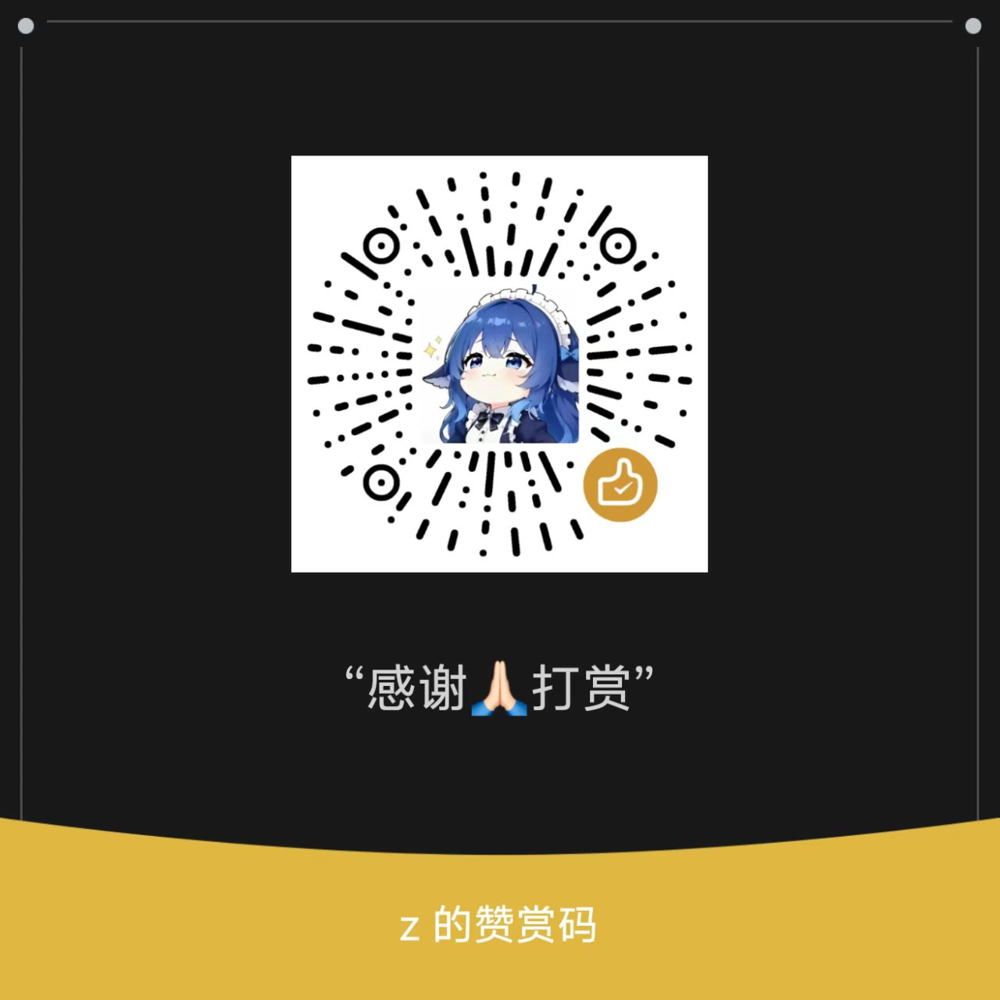

# dsh-theme-button

给 **DeepSeek Harness** 桌面版加一个悬浮主题挂件：切换官方外观，以及设置一层自定义背景。

挂件浮在界面之上，可以拖到任何位置并记住位置。所有界面自带半透明毛玻璃效果。

## 功能

| 功能 | 说明 |
| --- | --- |
| 悬浮挂件 | 默认在右下角，可拖动；位置自动记住；轻点开关面板，拖动时自动收起面板 |
| 官方外观 | 浅色 / 深色 / 跟随系统，写回 DSH 官方外观设置，不是插件自己的一套 |
| 自定义背景 | 纯色（6 个预设 + 自绘取色器）或图片（最多 6 张），二选一 |
| 背景参数 | 不透明度、模糊、亮度、饱和度，图片与纯色各有独立的不透明度 |
| 适配方式 | 填充 / 适应 / 平铺 / 拉伸 |
| 毛玻璃 | 挂件、面板、取色板三者一致；关闭自定义背景即恢复 DSH 原生外观 |

## 环境要求

- DeepSeek Harness 桌面版（Windows）
- 无需额外依赖

## 安装

先取得插件文件，再让 DSH 加载它。

### 方式一：本地链接安装（推荐）

把插件文件夹放到一个**固定的位置**（装好后不要再移动），然后执行：

```powershell
dsh plugin --profile desktop add link:C:\dsh-plugins\dsh-theme-button
```

### 方式二：从发布包安装

1. 解压发布包到一个固定位置，例如 `C:\dsh-plugins\dsh-theme-button`
2. 在该目录下运行：

```powershell
.\install.ps1
```

或者手工执行上面那条 `dsh plugin ... add link:` 命令。

### 完成后必须重启

**请完全退出并重新启动 DSH。** 插件的宿主部分只在启动时加载，仅刷新页面不够。

### 验证安装成功

重启后应该看到右下角出现一个调色板图标按钮。也可以访问：

- `http://127.0.0.1:<DSH 端口>/dsh-theme-button/version` —— 应返回一个版本号

## 使用方法

### 挂件

| 操作 | 效果 |
| --- | --- |
| 轻点 | 打开 / 关闭设置面板 |
| 按住拖动 | 移动挂件位置，鼠标变为抓手，面板自动收起；松手后位置自动保存 |
| 位置 | 重开 DSH 后保持上次位置；不会超出屏幕，也不会进入窗口按钮那一行 |

### 官方外观

面板第一段是「外观」，三选一：浅色 / 深色 / 跟随系统。选择会同步到 DSH 官方外观设置，与官方设置页双向一致。

### 自定义背景

面板第二段是「自定义背景」，总开关默认**关闭**。

打开总开关后，选择背景来源：

- **纯色**：点色板里的预设，或点最右边的方块打开取色器自定义
- **图片**：点「添加图片」选图，最多 6 张；点缩略图切换，点缩略图上的 × 删除

图片放满 6 张后，「添加图片」会自动变灰禁用；删掉一张即恢复。

### 取色器

| 操作 | 效果 |
| --- | --- |
| 上方方形区域 | 拖动手柄调整饱和度与明度 |
| 中间彩色条 | 拖动手柄调整色相，圆环中显示当前选中的颜色 |
| 底部输入框 | 手动输入颜色值，回车或点击别处即生效 |
| ▴ ▾ 按钮 | 在 HEX / RGB / HSL 三种格式之间切换 |

输入时三种格式都认：即使当前显示的是 HEX，直接输入 `rgb(255, 0, 0)` 也会按 RGB 解析。

### 参数说明

| 参数 | 范围 | 说明 |
| --- | --- | --- |
| 不透明度（图片） | 0–10 | 图片的显示强度，0 等于关闭整个效果 |
| 不透明度（纯色） | 0–10 | 纯色独立的一份，与图片那份互不影响 |
| 模糊 | 0–24px | 背景的模糊程度，默认 0 |
| 亮度 | 0–10 | 5 为 100%，即不做调整 |
| 饱和度 | 0–10 | 5 为 100%，即不做调整 |

### 适配方式

| 方式 | 效果 |
| --- | --- |
| 填充 | 铺满整个区域，超出部分裁掉（默认） |
| 适应 | 完整显示整张图，可能留边 |
| 平铺 | 按原尺寸重复平铺 |
| 拉伸 | 拉伸到铺满，会变形 |

## 首次安装的默认值

| 项目 | 默认值 |
| --- | --- |
| 挂件位置 | 右下角 |
| 外观 | 跟随系统 |
| 自定义背景 | 关闭 |
| 背景来源 | 未选择 |
| 取色器颜色 | `#8FB3A5` |
| 图片 | 无 |
| 适配方式 | 填充 |
| 不透明度 | 5 / 10 |
| 模糊 | 0px |
| 亮度 / 饱和度 | 5 / 10（100%） |

设置保存在本机浏览器存储中，重开 DSH 后全部沿用（面板的开 / 关状态除外）。

## 卸载

```powershell
dsh plugin --profile desktop remove dsh-theme-button
```

然后重启 DSH。如果还要清掉本机保存的设置，见「常见问题」最后一条。

## 常见问题

**挂件没有出现**

确认已经**完全重启** DSH，而不是只刷新页面。再访问 `/dsh-theme-button/version` 看是否返回版本号。

**背景效果看不见**

先确认「自定义背景」总开关是打开的，且不透明度不为 0。

**侧边栏 / 某个区域没有效果**

少数情况下背景层需要界面自身发生变化才会重新计算。切换一下图片或颜色，或打开一个新会话即可恢复。

**改了插件文件没有生效**

`lib/client.js`（界面部分）会自动重载，但同一版本 10 秒内最多重载 3 次，超过请手动刷新页面。`lib/index.js`（宿主部分）必须重启 DSH。

**想恢复出厂设置**

打开开发者工具，执行下面这行后刷新页面：

```js
localStorage.removeItem('dsh-theme-button.state.v2')
```

## 反馈问题

**这个项目不保证持续更新**，所以反馈的意义不是"让我去改"，而是**把问题记录下来**：
让后来遇到同样情况的人能在这里搜到答案，也让将来想接手的人知道有哪些坑。

所以无论你只是想说一句"这里好像不对"，还是发现了具体的 Bug，都欢迎告诉我：

| 请提供 | 在哪看 |
| --- | --- |
| 你做了什么操作 | 越具体越好 |
| 期望的结果 / 实际的结果 | 分别是什么 |
| 插件版本 | `package.json` 里的 `version`，或访问 `/dsh-theme-button/version` |
| DSH 版本 | DSH 的「关于」页 |
| 截图 | 最有效，能省很多来回 |

**联系方式**

- **邮箱：`zhanghz1130@outlook.com`**（标题里带上 `dsh-theme-button`，方便我归档）
- **GitHub Issues**：[提交 Issue](../../../issues) —— 推荐用这个，问题公开留存，别人能直接看到

**我不承诺一定会修**，但会尽量看一眼。如果问题只影响你的个别情况，也欢迎自行修改——
MIT 许可，随便改、随便发。
## 已知限制

- 只支持 Windows 桌面版 DSH（边框预留区的处理依赖 Windows 窗口变量）
- 取色器与面板都绘制在自己的浮层里，不会与 DSH 原生菜单抢占最上层：DSH 自己的菜单和对话框会盖住它们
- 图片上限 6 张，且受浏览器存储容量限制

## 项目文件

| 文件 | 作用 |
| --- | --- |
| `package.json` | 插件清单 |
| `cordis.patch.yml` | 让 DSH 在启动时加载本插件 |
| `lib/index.js` | 宿主部分：注册路由、注入页面脚本、读写外观偏好 |
| `lib/client.js` | 界面部分：挂件、面板、取色器、背景效果 |
| `install.ps1` | 安装辅助脚本 |
| `LICENSE` | 许可协议 |

`_dev/` 是开发资料（历史备份与补丁脚本），不参与分发，可以删除。

## 开发

```powershell
# 打包：只收集该分发的文件，输出到 dist/
.\pack.ps1
```

改完 `lib/client.js` 后页面会自动重载（它每 2.5 秒检查一次版本号）；改完 `lib/index.js`
需要重启 DSH。

代码里有较多注释，说明了每一处设计的取舍；遇到疑问也欢迎直接[反馈](#反馈问题)。

## 关于这个项目

这个插件是**用 AI 辅助完成的**。我本人不是程序员，没有独立写出这些代码的技术能力，
但我投入了大量时间去提需求、试效果、找问题、反复验证，也承担了 AI 开发工具的费用。

> **项目状态**：功能已完整可用。我**不承诺持续更新**——它现在够用，我就不一定继续折腾了。
> 代码是 MIT 许可，任何人都可以自己改、自己发。

如果你觉得它好用，欢迎请我喝杯水。金额随意，**每笔 2 元、凑够 20 个人我就不亏了**。

微信扫码即可打赏，金额随意。感谢你的支持！



### 感谢支持

感谢每一位打赏者的支持（按时间顺序）：

<!-- 有人打赏后，在这里加一行，例如：- 2026-10-12 @某某 ￥2 -->

- 虚位以待 —— 你会是第一个吗？

---

## 许可
MIT，见 [LICENSE](LICENSE)。